<!-- The GitHub front page and the PDF are built from this one file. Edit here, then run tools/make_pdf.py. -->

# Putting Plastic on a Pedestal

### Experimental methods of plastic waste reduction for 3D printing

*Hollow towers, fat lobes, thin caps and tethers strung between walls: a hobbyist's field guide and a defensive publication*

**Matthew Armstrong** ([The-Dorkknight](https://github.com/The-Dorkknight)) · Version 1.0 · First published 10 November 2026
Text and figures: [CC BY-SA 4.0](LICENSE.md) · Code: PolyForm Noncommercial 1.0.0 · The software: [cura-hybrid-supports](https://github.com/The-Dorkknight/cura-hybrid-supports)

📘 **[The whole paper as one PDF](docs/putting-plastic-on-a-pedestal.pdf)**

> **Physically untested.** Every number in this paper comes from geometry code, Cura's slicer, the G-code it writes, or a simulation. None of the supports described here, in the versions described here, has been printed and snapped off yet. I have nearly seventy unfinished projects on the go at once, and a job, a social life and the need to sleep keep interfering with finishing them. The one physical test that did happen (an early tether print in October, an older version) is reported in section 7, mostly because it went wrong in useful ways. Treat every saving below as a prediction, and treat section 11 as an invitation.

---

## Abstract

Support material is plastic you pay for, wait for and then throw in the bin. On a tall part with a wide roof, Cura's normal support can easily weigh more than the part. This paper describes a Cura plug-in, *Hybrid Supports*, that replaces a block of support with a few **pedestals**: hollow towers with a wide hollow head of rounded lobes, standing on gusseted feet, topped with a thin four-layer interface cap. It also describes **tethers**, an alternative for roofs that sit between two walls: strips strung from wall to wall a little under the roof, with the same cap on top, and no tower at all.

On three test parts 200 x 200 mm across, sliced in Cura 5.13 for an Elegoo Neptune 4, the lobed pedestals used **64 % less support plastic than Cura's normal support with a 50 mm stem and 84 % less with a 150 mm stem**. Against Cura's tree support they used **24 to 26 % less on the tall parts but 29 % more on the short one**, so the saving is mostly a tall-part effect. A tether span limit (a warning above 90 mm, a hard stop at 110 mm) was set from a physical sag simulation.

The methods, the dead ends and every variation I could think of are written down here and placed in the public domain as prior art, so they stay free for everyone to use. Nothing has been printed yet (see the box above, and my calendar).

---

## Contents

0. [Why publish this at all](#0-why-publish-this-at-all)
1. [The problem: we print bins](#1-the-problem-we-print-bins)
2. [A five-minute primer](#2-a-five-minute-primer)
3. [The idea on one page](#3-the-idea-on-one-page)
4. [How a pedestal is built](#4-how-a-pedestal-is-built)
5. [Tethers: support with no floor](#5-tethers-support-with-no-floor)
6. [Experiments: three big parts](#6-experiments-three-big-parts)
7. [Dead ends, bugs and one real print](#7-dead-ends-bugs-and-one-real-print)
8. [Prior art](#8-prior-art)
9. [Defensive disclosure](#9-defensive-disclosure)
10. [Limitations and open questions](#10-limitations-and-open-questions)
11. [A test plan for anyone with a printer and a free weekend](#11-a-test-plan-for-anyone-with-a-printer-and-a-free-weekend)
12. [How this was made](#12-how-this-was-made)
13. [Licence](#13-licence)
14. [How to cite](#14-how-to-cite)
15. [References](#15-references)

---

## 0. Why publish this at all

- **To keep it free.** A defensive publication puts an idea on the public record with a date on it, so nobody can patent it later and charge the rest of us for it. I don't want to own these supports. I want nobody to own them.
- **To write down the dead ends.** Half of this project was trying things that didn't work. A failed idea that's written down saves the next person a weekend. A failed idea that isn't gets reinvented forever.
- **To get it printed by someone.** See the box at the top. If you print any of this, good or bad, I'd love to know (section 11 says what to measure).
- **Because it's interesting.** Support is the least loved part of 3D printing, and it hides some lovely geometry.

## 1. The problem: we print bins

FDM printers build parts out of thin layers of melted plastic, and each layer needs something under it. Where a part has a roof, a ledge or anything that leans out too far, the slicer adds **support**: a scaffold that is printed, used once, snapped off and thrown away.

How much? Take the plainest roof there is: a U shape, 200 mm wide, with legs 10 mm thick and a 5 mm roof whose underside is 150 mm above the bed. Sliced in Cura 5.13 with the Elegoo Neptune 4 profile, the U itself takes about 6.5 hours to print. Cura's normal support under it is **328.7 m of filament, about 980 g**: most of a 1 kg spool, and roughly another 17 hours of printing, to hold up a roof that weighs a fraction of that. Tree support does much better (68 m, 203 g), and that is the bar this paper has to clear.

The aim is simple to say: **put less plastic in the bin without letting the part droop.**

## 2. A five-minute primer

If you already know your bridges from your interfaces, skip to section 3.

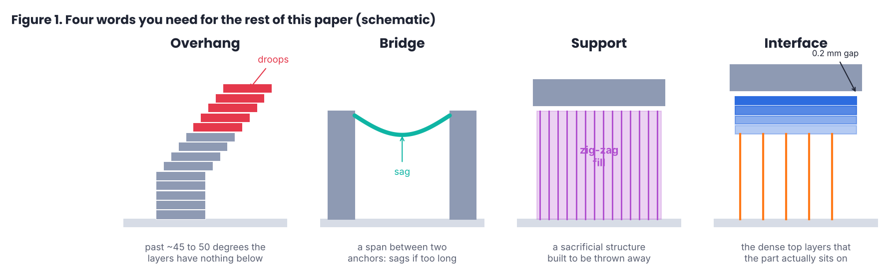

- **Overhang.** Each layer can lean out a little past the one below, but past about 45 to 50 degrees from vertical there is nothing under the new plastic, and it droops. Cura's *Support Overhang Angle* decides where that line is.
- **Bridge.** A strand of plastic stretched between two anchors in mid-air. Bridges work surprisingly well when they are short, fast-cooled and taut, and they sag when they are long.
- **Support.** The sacrificial scaffold. Cura's "normal" support fills the whole space under an overhang with a zig-zag; tree support grows branches that merge into a few trunks.
- **Interface.** The top few layers of a support, printed denser, so the part's first layer has something flat to sit on. It is separated from the part by a tiny air gap (0.2 mm here) so it peels off.

The trade-off is always the same. More support means a nicer underside and less risk, and more support also means more plastic, more time and more picking at the part with pliers afterwards.

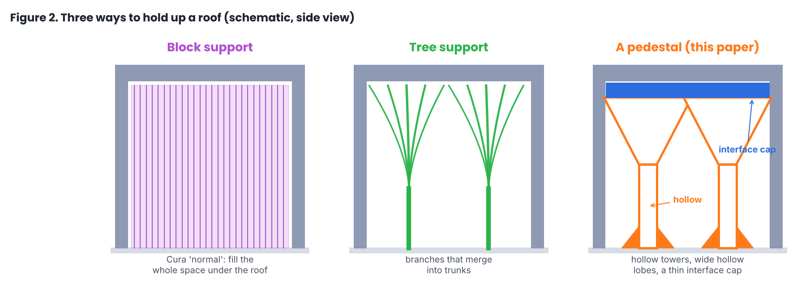

## 3. The idea on one page

A roof only needs holding up **at its underside**. Everything between the bed and the underside only has to carry that load down and not wobble while the nozzle drags past it. Solid or zig-zag support spends most of its plastic on that in-between part.

So:

1. **Hollow towers.** Carry the load down a tube with two walls and nothing inside. A tube is stiff for its weight (this is why bicycles aren't made of solid rods).
2. **Wide hollow heads.** Flare out at 45 degrees (the steepest a printer can manage without support of its own) in a few fat rounded lobes, so one tower reaches a lot of roof.
3. **A thin cap.** Lay a four-layer interface across the tops of the lobes: a lattice to bridge between them, a second lattice across it, 50 % rings and a 100 % top layer. The part sits on that.
4. **Feet.** Gussets and a foot at the bottom, so a tall thin tower doesn't fall over.
5. **Tethers, where there are walls.** If a roof sits between two walls of the part, skip the towers altogether: string strips from wall to wall a little under the roof and put the cap on those.

That's the pedestal. The rest of this paper is the detail, which is where the work was.

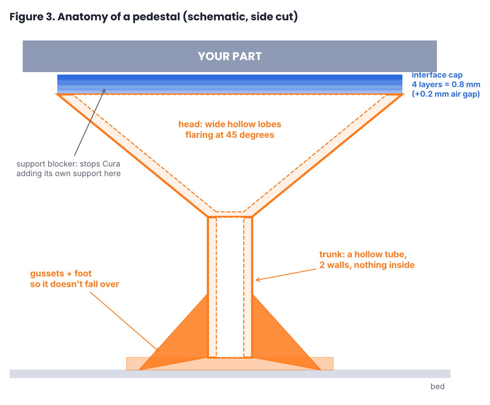

## 4. How a pedestal is built

Hybrid Supports is a Cura plug-in (Python, Cura 5.x; tested in Cura 5.13 on Linux). You select a part, choose a head shape and press *Generate*. The plug-in adds ordinary meshes to the scene: towers, caps, and a *support blocker* over each overhang so that Cura doesn't add its own support on top. It then fixes up a few layers in the G-code when the file is saved.

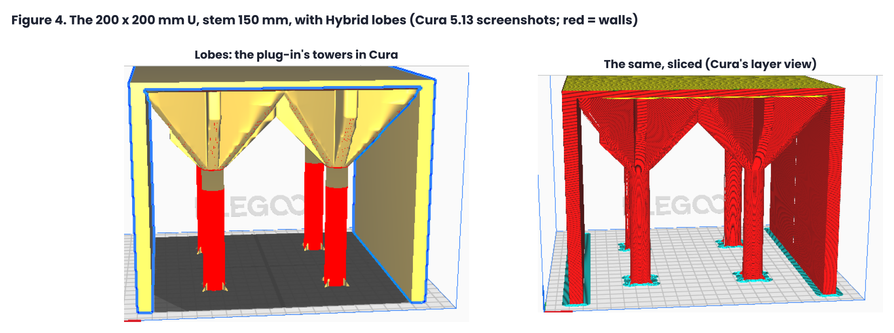

### 4.1 Finding what needs holding up

- **Overhangs.** A triangle of the part needs support when it faces down more steeply than the support angle (`-n_z > cos(angle)`, the same meaning as Cura's setting; the plug-in uses Cura's own angle by default).
- **Regions.** Neighbouring overhang samples are grouped into regions. Each region gets **one support if one can reach it**. More than one appears only when one can't (section 4.4). Early versions split everything into fixed 30 mm chunks and made a forest of pillars; the user (me) objected.
- **Landing.** For every sample, a ray is cast straight down to find what's below: the bed, or another part of the model. A tower may only stand on a clear, nearly flat landing (flatness within 1 mm), and the column above it is checked to be clear of the model all the way up. One early bug had a tower start in mid-air because its landing ray hit a rib.

### 4.2 Hollow towers that really are hollow

Cura is strict about support meshes. It fills them with the support pattern (zig-zag on most profiles), and the settings that would make them print as outlines (support wall count, pattern and density) **can't be set per mesh** in Cura 5.13. So the first versions printed what looked like towers in the preview as zig-zag scribble inside a thin strip: no proper walls at all.

The fix (0.6.1) was to stop calling them support. The towers are added as **normal meshes** with their own per-mesh settings: walls only, no infill, no top or bottom skin, the support line width, the support speed and flow. Cura prints them as closed wall loops, which is exactly what a hollow tube needs. The trunk is two lines thick. Its radius is a quarter of the distance it has to reach, kept between 2 and 8 mm. Four gussets (6 mm high, 5 mm long) and a foot keep it upright.

### 4.3 The heads: lobes, cone and branch

The **head** is where a narrow trunk becomes a wide support.

- **Lobes (the default).** A star of hollow capsules, each **8 mm wide**, printed with 2 walls. Every lobe flares out at 45 degrees towards a corner or an edge of the roof, and new lobes are added only where a bridge between two of them would be longer than the maximum bridge span (20 mm by default). Edges that rest on a wall of the model count as supported already.
- **Cone.** A thin hollow cone (a 2-line wall, 64 sides) flaring at 45 degrees from a circle on the bed, with an X of ribs inside.
- **Branch.** Straight 3-line webs from a rounded hub, like the spokes of a wheel.

Why are the lobes so fat? Version 0.6.1 used six thin webs meeting at a point, and in review I pointed out two things: the sharp inner corners are stress concentrators, and a 0.8 mm web is floppy sideways when the nozzle drags past it. Bending stiffness across a web grows with the cube of its thickness. A hollow lobe whose two walls sit about 8 mm apart behaves like a box section, roughly (8 / 0.8)² = 100 times stiffer across than a 0.8 mm slab for the same wall material per unit length (ignoring the ends). So 0.6.2 went to fewer, wider lobes.

The joins are rounded with a **smooth maximum**. Each lobe is a capsule, which in polar form around the trunk is a radius for every direction. The star's outline in each direction is a polynomial smooth maximum of the lobes' radii, with a 3 mm width. That rounds the inner corners without moving the lobes' straight sides. The outline is sampled in 128 directions, about 1 mm per step at the tips, which keeps the number of nozzle moves down.

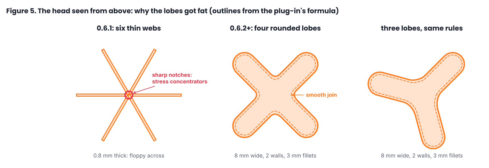

### 4.4 Built to size, and splitting when it can't reach

A 45 degree flare can only reach out as far as it is tall. When a normal tower can't reach the whole region, the plug-in first tries a **support built to size**: one star (or cone) as wide as the region needs, each arm with its own foot along its line, as far as the floor beside it is clear and level. If that support reaches at least **85 %** of the region, it is kept. If not, the region is split in two and each half tries again (up to five times).

On the 200 mm parts this produced **two to four towers**, reaching 91 to 98 % of the roof. The last few percent are corner tips, left to the cap alone.

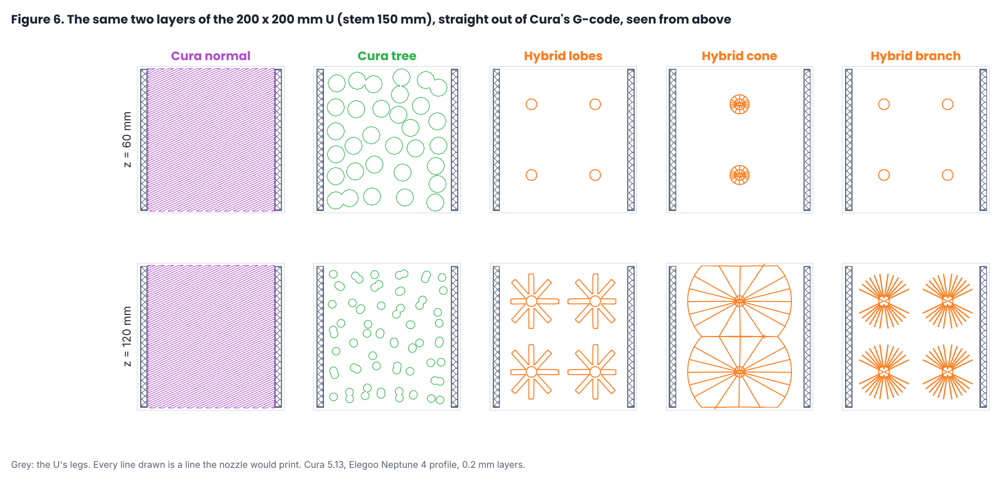

Figure 6 is the clearest picture of the whole idea. Each panel is a real layer of real G-code, seen from above. At 60 mm up, Cura's normal support is a solid hatch across the full 200 x 200 mm. Tree support is about forty separate round branches. The pedestal is four small rings.

### 4.5 The interface cap

Since the towers print as walls, Cura's support interface no longer applies to them, and without an interface a part's first layer would bridge everything between the lobe walls and droop. So every pedestal (and every tether set) gets a **cap**: a separate normal mesh of four layers, 0.8 mm in all, sitting directly on the tower tops (two normal meshes stack with no gap), with the usual 0.2 mm air gap above it to the part.

Cura can only print a cap one way (as skin), so when the file is saved the plug-in **rewrites the cap's layers in the G-code**, finding them by Cura's `;MESH:` comments:

| Layer | What it is | Why |
|---|---|---|
| 1 | Lattice, 3 mm pitch, slowed to 20 mm/s | bridges across the lobe tops; slow and cool so it doesn't sag |
| 2 | Lattice, crossing the first | turns lines into a grid |
| 3 | Concentric rings at 50 % | a near-solid layer that's cheap and quick |
| 4 | 100 % solid top | the flat surface the part actually sits on |

On a flat roof the cap is one big sheet. On a slope it becomes a staircase of convex pieces, one per 0.8 mm height band. Round a dome it splits into 8 sectors. Each piece is cut back from the model with half-planes, across the direction of the nearest model surface.

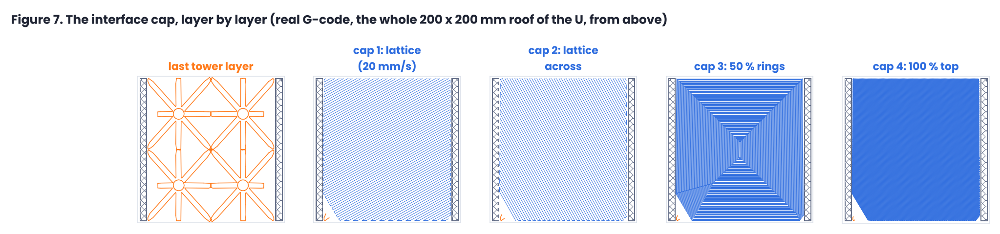

A side effect of Figure 7: look at the last tower layer. At the top, the lobes of four towers meet and make a grid. That wasn't designed, it fell out of the rules.

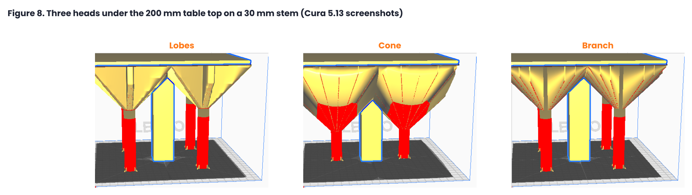

## 5. Tethers: support with no floor

Tethers came from something I noticed on failed prints. When a support collapses, the loose "fuzz" often catches on a nearby wall, and within about 10 mm it has built itself into something solid. So why not do that on purpose?

**What it does.** For each overhang, the plug-in tries 12 directions and looks for two walls of the model facing each other. It keeps the direction with the shortest span where most strips find a wall at both ends. Then:

- Strips are **3 lines wide** (about 1.26 mm), spaced so they cover **20 %** of the roof, evenly, with the first and last strip 0.2 mm in from the two ends of the overhang.
- They start **10 mm below** the roof and go straight up to the cap.
- **Every other layer is shifted half a line width** (a G-code post-process, because Cura flattens any per-layer zig-zag built into the shape). Each line then sits half on the one below, so the strip is a stack of half-overlapping lines that snaps apart easily.
- The **first three layers** are bridges in mid-air, so they are slowed to 20 mm/s with the part fan at 100 %. Cura doesn't apply its bridge settings to support, and the Neptune 4 profile otherwise prints support at 165 mm/s.
- The **cap** is the same four-layer stack, with the first layer under-extruded to 85 % so a hot bead fuses with a thin strip instead of melting through it.
- Tethers refuse an overhang if more than 10 % of it would be farther than 1.5 strip pitches (at least 8 mm) from any strip (an L-shaped corner, for example). Lobes take over.

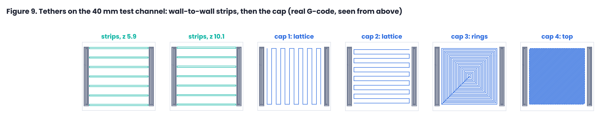

### 5.1 How far can a strip go?

The obvious question, and the first version's answer (a 120 mm limit) turned out to have no source at all: it was a search distance in the first tether code, written when the test parts were 40 mm wide. When I asked where it came from, nobody (human or software) could say. So I went looking:

- Published bridging guidance is all over the place: **10 to 30 mm** in conservative guides, **50 to 80 mm** "well tuned", and **about 100 mm** in hobbyist reports with very good cooling (one forum post measured 96 mm with under 0.3 mm of sag). I found nothing at all for 180 mm.
- An AI chatbot confidently told me the Neptune 4 could bridge 100 to 150 mm and cited a review. The review gives no bridging distance whatsoever. Lesson noted.

So I wrote my own **sag simulation** (included in the plug-in's repository). A PLA strand leaves the nozzle, is drawn taut by the moving head, hangs like a string while it's hot, and freezes into shape as it cools past its glass transition, element by element, while the fan blows on it. One factor was fitted to published Ender 3 guidance. Everything else, including every Neptune 4 number, comes from the physics. Its findings:

- Up to about **60 mm**, both printers stay under 0.4 mm of sag at any sensible speed.
- Past about **100 mm**, cooling stops being the limit. The frozen 0.32 mm strand simply bends under its own weight (sag grows with span to the fourth power), which is a ceiling for a 0.4 mm nozzle and 0.2 mm layers on any printer.
- Conservatively the Neptune 4 manages **70 to 90 mm**. With rigid walls, where the strand's shrinkage pulls it taut after it lands, that rises to **85 to 130 mm**.

From that, the rule: **up to 90 mm, tethers build. From 90 to 110 mm they build, with a warning. Over 110 mm, the plug-in refuses, says why ("the walls are 180 mm apart, over the 110 mm limit"), and builds lobes instead.** The warning, for the record, reads: *"the vengeful Flying Spaghetti Monster may appear suddenly for trying to violate the laws of physics."* I consider this an accurate engineering statement.

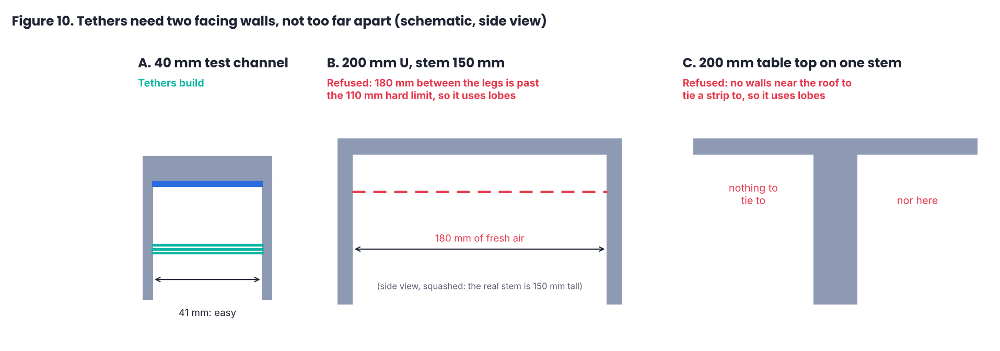

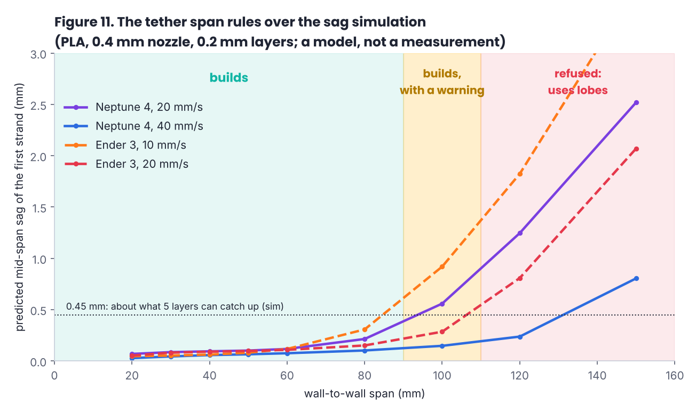

## 6. Experiments: three big parts

Small test parts flatter everyone, because the fixed costs dominate. So I asked for big ones, with long stems.

**Parts.** A U 200 x 200 x 200 mm (10 mm legs, 5 mm roof) with the roof's underside **50 mm** and **150 mm** above the bed, and a 200 x 200 mm **table top on a single 30 x 30 mm stem**, 150 mm up.

**Method.** Each part was sliced headless in Cura 5.13 with the stock Elegoo Neptune 4 profile (PLA, 0.4 mm nozzle, 0.2 mm layers): bare, with Cura's normal support, with Cura's tree support, and with the plug-in's lobes, cone and branch heads (Generate, then save, so the caps are written in). Support plastic is the job minus the bare part, counted move by move from the G-code. Time comes from a plain distance-over-feed-rate model of every move, because Cura's own estimate can't see the slowed cap and tether layers written after slicing, and so flatters the plug-in. Grams assume PLA at 1.24 g/cm³.

| Part (bare print) | Support | Support plastic | Support time | Whole job |
|---|---|---|---|---|
| U, stem 50 mm (230 min) | Cura normal | 109.8 m · 328 g | 342 min | 574 min |
| | Cura tree | 30.5 m · 91 g | 89 min (+45 travel) | 359 min |
| | **Hybrid lobes** (4 towers) | **39.4 m · 118 g** | 137 min | 374 min |
| | Hybrid cone (2 towers) | 27.0 m · 80 g | 99 min | 343 min |
| | Hybrid branch (8 towers) | 83.2 m · 248 g | 270 min | 573 min |
| U, stem 150 mm (393 min) | Cura normal | 328.7 m · 980 g | 1009 min | 1404 min |
| | Cura tree | 67.9 m · 203 g | 202 min (+99 travel) | 666 min |
| | **Hybrid lobes** (4 towers) | **51.5 m · 154 g** | 173 min | 583 min |
| | Hybrid cone (2 towers) | 87.1 m · 260 g | 282 min | 720 min |
| | Hybrid branch (4 towers) | 98.6 m · 294 g | 317 min | 786 min |
| Table top, stem 150 mm (206 min) | Cura normal | 363.5 m · 1084 g | 1115 min | 1313 min |
| | Cura tree | 76.7 m · 229 g | 228 min (+77 travel) | 496 min |
| | **Hybrid lobes** (4 towers) | **56.8 m · 169 g** | 192 min | 400 min |
| | Hybrid cone (2 towers) | 99.3 m · 296 g | 321 min | 570 min |
| | Hybrid branch (4 towers) | 107.4 m · 320 g | 346 min | 617 min |

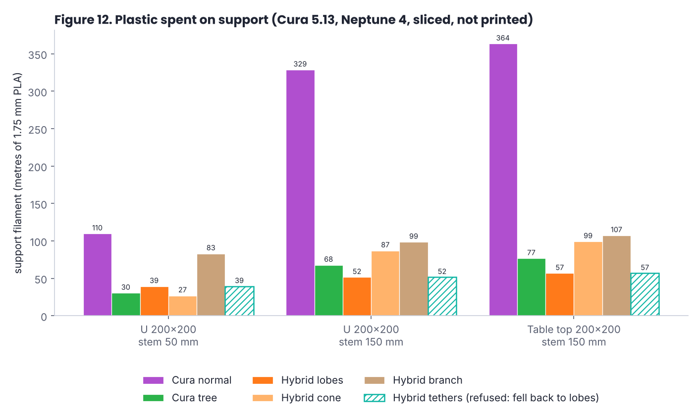

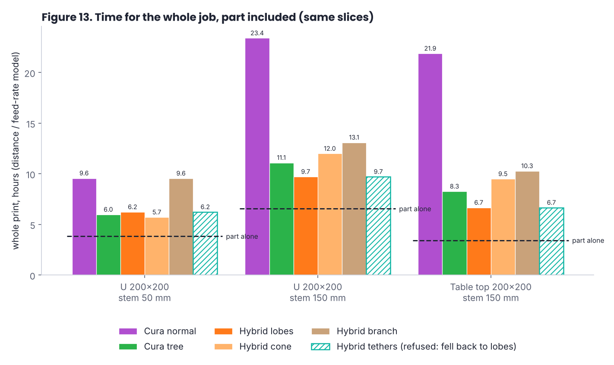

### 6.1 What it says

- **Against Cura's normal support,** lobes use 64 % less support plastic on the short U and **84 %** less on both tall parts. The whole job is 35 %, 58 % and 70 % shorter.
- **Against tree support,** lobes use 24 % less on the tall U and 26 % less on the table top, and the whole job is 12 % and 19 % faster. On the short U they lose: 29 % **more** plastic. At 50 mm the cap (a full 0.8 mm sheet under 35,000 mm² of roof, 5.2 m) is a seventh of the support, and a tree is already cheap.
- **Height is the whole story** (Figure 14). Tripling the stem from 50 to 150 mm triples Cura's normal support, more than doubles the tree, and adds only about 30 % to the pedestals. A hollow tube costs little per extra millimetre of height. A tree pays for every branch all the way down.
- **The cone** is the cheapest of everything on the short U (27.0 m, two towers), but its flared shell gets expensive when tall. It only wins on short, wide parts.
- **Branch** lost everywhere. Lots of thin webs is a lot of nozzle travel.
- **Tethers** refused all three parts, correctly (Figure 10): the U's legs are 180 mm apart and the table top has no walls. They fell back to lobes, so their hatched bars in Figures 12 and 13 are the lobes numbers. Where they *can* work, they win (Figure 15). On an earlier benchmark with a 100 x 100 mm channel roof between two walls (sliced before the cap stack existed, with Cura's own time estimate), tethers used 6.8 m of support at 100 mm up and 6.9 m at 150 mm, against 7.2 and 7.6 m for lobes, 23.1 and 34.7 m for Cura's sparsest support (5 % zig-zag, no roof) and 28.0 and 41.3 m for tree support. That is about 5 to 10 % less than lobes and about 75 to 85 % less than tree support. Note the 100 mm span: under the new rules that tether would now build with a Flying Spaghetti Monster warning.

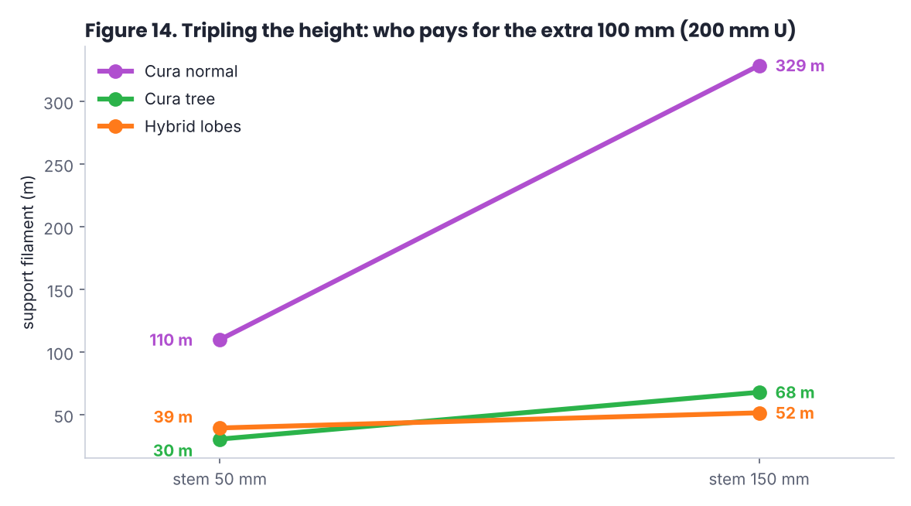

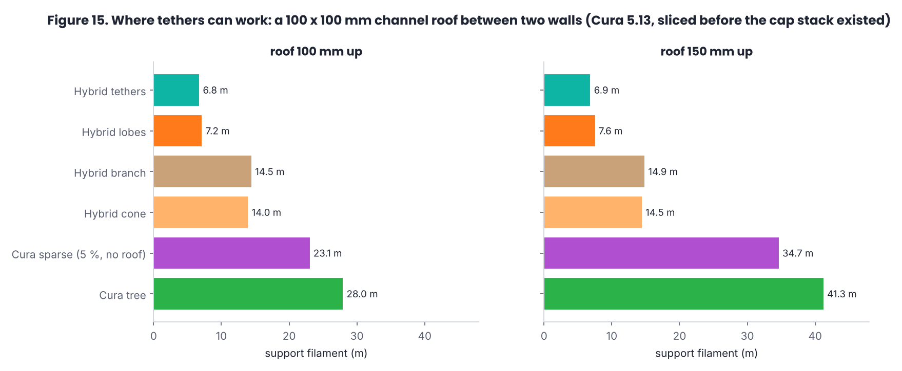

### 6.2 What it doesn't say

- **Whether any of it holds.** Four 8 mm lobes standing 150 mm tall may wobble. A 3 mm lattice bridging 15 to 20 mm between lobes may sag. If a pedestal falls over, the saving is zero and you've lost the part as well.
- **Time to the second.** The move model ignores acceleration, so real times will be longer for everyone, and Cura's own estimate tells a kinder story for the plug-in (lobes support 203, 291 and 310 min against tree 300, 504 and 555 min). I've used the stricter numbers.
- **Removal effort, surface finish and success rate.** All unmeasured.
- **Other printers, materials or tuned tree settings.** One printer profile, PLA only, stock tree settings.

## 7. Dead ends, bugs and one real print

In roughly the order I tripped over them:

| What happened | Why | What changed |
|---|---|---|
| Towers printed only in places, some starting in mid-air | Elegoo's profile deletes support areas under 3 mm², which includes a thin tube's whole layer; one landing ray hit a rib | per-mesh minimum support area 0; every tower checks a clear column to a flat landing |
| A wide gap got three pillars | regions were split at a fixed 30 mm | one support per region unless it can't reach |
| Single-line X ribs (the cheapest possible head) | Cura shrinks support areas by half a line before printing, so a one-line rib vanishes entirely | dropped; the narrowest clean rib is a two-line loop, which is exactly what a lobe wall already is |
| **First real print** (October, an early tether test box) | the tethers were too sparse, so much of the cap had nothing under it, and the roof lattice touched the walls | tethers cover 20 %, evenly spaced; the cap is kept clear of the walls |
| Tether lines came out as zig-zag springs | the profile's 65 degree support line direction crossed the strips | lines run along the strips; a straight line pulled taut bridges far better than a chain of diagonals |
| Per-layer stagger built into the shape vanished | Cura slices each layer at top and bottom and keeps what they share | the stagger is written into the G-code after slicing |
| Spiderweb supports, radial tether fans, stepped tethers | in review, regions of roof with nothing under them, or no gain over straight tethers | dropped (the spiderweb is in the research notes for anyone braver) |
| "Zig-zag towers, and 4 towers when 1 would do" (my review of 0.6.0) | Cura fills support meshes with zig-zag; a ray cast from inside the base plate made every wall think the model was right above it, so it split, and split again | towers as walls-only normal meshes; rays cast from above the foot; per-arm feet |
| Sharp notches, floppy webs (review of 0.6.1) | thin webs meeting at a point | fat rounded lobes with smooth joins (Figure 5) |
| "They don't have any support interface, the part will droop" (review of 0.6.2) | walls-only towers get no Cura interface | the four-layer cap on every support |
| Cone slices on the tall parts cut off after 4 layers | the cone's reach was taken from the farthest point in a 5.6 degree sector, which on a 100 mm overhang lies well off the ray, so the shell flared 17 mm past the roof and off the bed | reach measured along the ray |
| A 120 mm tether limit with no source | a search distance that became a rule | research plus the sag simulation: 90 mm warning, 110 mm hard limit |

## 8. Prior art

An informal search (web, papers, Google Patents, Cura plug-ins), not a professional one. If you know of anything closer, please tell me and I'll add it.

| Work | What it does | How it relates |
|---|---|---|
| Dumas, Hergel, Lefebvre, *Bridging the Gap: Automated Steady Scaffoldings for 3D Printing* (SIGGRAPH 2014) | scaffolds of horizontal bridges held up by vertical pillars, optimised for low material and stability | the closest academic idea to tethers (bridges between anchors) and to sparse pillars; there the bridges hang between printed pillars, not the part's own walls |
| Vaněk, Galicia, Beneš, *Clever Support* (Computer Graphics Forum, 2014) | tree-like support grown from the contact points down | the ancestor of today's tree supports |
| Freire, Hornus, Perchy, Lefebvre, procedural bridges-and-pillars support (Eurographics short paper, 2022) | pillars joined by bridges; on their test model the support length didn't drop, the gain was fewer contact points | supports the observation that the win is in the shape, not just the count |
| Autodesk, US 10,775,770 B2 (priority 2017, filed 2018) | thin single-bead support walls offset from the part perimeter, support where bridged infill is too long, small Z gaps to ease removal | thin-walled supports in general; I couldn't read its claims in full and draw no conclusion |
| US 2021/0283856 A1, "Automatic reusable support for 3D printing" | not read (the page wouldn't load) | listed for completeness |
| Cura tree support, PrusaSlicer organic supports | branching supports from the bed | the main comparison in section 6 |
| Cura *lightning infill* | branches grown from inside walls only where top surfaces need them | the same instinct as tethers (anchor on the part, grow only where needed), but only inside a part |
| Arc overhangs (Steven McCulloch, 2022) and wave overhangs (2026) | print the roof's first layer as arcs or ripples growing from a supported edge, no support at all | a different route to the same goal; slow (about 2 mm/s) |
| *CustomSupportCylinder* (Cura plug-in by 5@xes) | user-placed cylinders, tubes and other shapes as support | hand-placed towers; no automatic sizing, heads or caps |
| Armstrong, *Fin-ally Supported* (2026) | my own shark-fin supports for long tilted faces | a sister method, already published |

As far as I could find, nothing describes the combination here: **hollow towers printed as walls, sized from the overhang, with wide filleted lobe heads and per-arm feet, a four-layer interface cap rewritten into the G-code, and wall-to-wall tethers with staggered layers, slowed bridge layers and a simulated span limit.** Each piece on its own has relatives. I'm claiming nothing, and only writing it down.

## 9. Defensive disclosure

The following methods, and the obvious variations of each, are hereby published and dedicated to the public. They are described well enough for a person skilled in FDM slicing to build them, and the working code is published alongside (section 13).

**9.1 Pedestal supports**
1. Generating support for an overhang region as one or more hollow towers printed as closed wall loops (walls only, no infill, no top or bottom skin), added to the slicer as normal model meshes with per-mesh settings rather than as support meshes, so that the slicer's global support pattern does not apply to them.
2. Choosing one tower per overhang region and adding more only when one cannot reach it: first trying a single support "built to size" (a hub-less star or cone wide enough for the region, with each arm on its own foot along its line), keeping it when it reaches at least a set share of the region (85 % here, any value 50 to 100 %), and otherwise splitting the region and repeating, to a set depth.
3. Heads made of hollow capsule-shaped lobes flaring at the printer's overhang limit (45 degrees here, any angle 30 to 60), each lobe much wider than its wall (8 mm here; any width 3 to 20 mm; 2 walls; 1 to 4 walls), with the number and direction of lobes chosen so that no bridge between lobes, or between a lobe and a supported model edge, exceeds a maximum bridge span.
4. Joining lobes with a smooth maximum of their polar outline radii (polynomial, exponential or any other smooth-max or fillet), so inner corners are rounded by a set radius without moving the lobes' sides; sampling the outline in a set number of directions to bound the number of print moves.
5. Hollow cone heads built to size, with internal ribs to the region's corners, with the cone's reach in each direction measured along that direction from overhang samples near it, not as the farthest point in an angular sector.
6. Gussets and feet: triangular gussets round the trunk's base (any count, height and length), feet along each arm's line as far as the floor is clear and level, or a round foot as wide as is clear.
7. A support blocker (anti-overhang volume) over each generated support's overhang, so the slicer adds no support of its own there.

**9.2 Interface caps**

8. Placing on top of every generated support a separate model mesh of a few layers (0.8 mm here; any thickness 0.4 to 2 mm), stacked directly on the support with no Z gap and kept a contact gap (0.2 mm here) below the part, and rewriting that mesh's layers in the G-code after slicing, identified by the slicer's mesh-name comments, as an interface stack: one or more sparse lattice layers (any pitch; any angle), optionally slowed and/or under-extruded on the first; then a partly filled layer (rings at 50 % here, any pattern and density); then a fully solid top layer.
9. Building caps on sloped or curved undersides as a staircase of convex pieces, one per height band, splitting ring-shaped bands into sectors, and cutting each piece back from the model with half-planes perpendicular to the direction of the nearest model surface.

**9.3 Tethers**

10. Supporting an overhang that lies between two facing walls of the part itself with strips strung from wall to wall below it, starting a set distance below the overhang (10 mm here, any 2 to 30 mm), covering a set share of the overhang (20 % here, any 5 to 60 %), evenly spaced with the first and last strip at the overhang's ends, choosing among several directions the one with the shortest span for which most strips find walls at both ends; refusing when a set share of the overhang would be beyond a set distance from every strip.
11. Shifting the strips' lines by a fraction of a line width (half here) on alternate layers by post-processing the G-code, so each layer rests partly on the one below and the strip separates easily; or shifting by any pattern of offsets per layer.
12. Printing the first one or more strip layers (three here) as bridges: slowed, with increased part cooling, optionally changed flow; and printing the first cap layer over the strips under-extruded (85 % here).
13. Limiting the wall-to-wall span with a warning threshold and a hard limit (90 and 110 mm here, any values), derived from a physical model of strand sag (drawing tension, hot-zone droop frozen in at the glass transition, tensioned-beam sag of the frozen strand, forced-convection cooling by the part fan), optionally per printer, speed, nozzle, layer height and material; and, past the hard limit, falling back to another support type automatically and telling the user why, with the measured span.

**9.4 Variations** that are also disclosed: any of the above in any slicer (Cura, PrusaSlicer, OrcaSlicer, Bambu Studio, Simplify3D or others) or in the printer firmware or host; written as slicer plug-ins, post-processing scripts, or native slicer features; in any FDM/FFF material; with tethers of other cross-sections (single lines, wider strips, I-beams) and towers of other cross-sections (square, polygonal, elliptical, multi-tube); with lobes of other shapes (teardrops, ellipses); with the lattice, ring and solid layers in other orders or counts; combined with arc or wave overhangs grown from the lobe tops or the strips; and with any of the numeric values above changed.

## 10. Limitations and open questions

- **Nothing in this version has been printed.** I can't say this often enough.
- **Stability of tall thin towers** under nozzle drag, especially 150 mm tall on two-line walls.
- **Cap sag** between lobes, and whether 85 % flow on the first cap layer helps or leaves gaps.
- **Tether sag** past 60 mm, and whether the "layers above catch up within about 10 mm" rule from my failed prints holds.
- **Removal:** whether pedestals come off in one piece, and what the 0.2 mm gap leaves on the underside.
- **Wall marks:** tethers touch the part's walls and will leave marks there.
- **Shared settings:** some Cura settings are per job, not per part, so tethers change the support X/Y distance, pattern and roof for the whole job, which affects other supports on the same plate.
- **One printer profile, one material, one slicer.** The sim's speed and fan advice suggests the right numbers differ a lot between printers.
- **Prior-art search** was informal. Not legal advice.

## 11. A test plan for anyone with a printer and a free weekend

If you print any of these, please open an issue on the plug-in's repository with photos and, ideally, these numbers:

1. **The test plate** (`test-prints/` in the plug-in repository): six small parts, one per support style, one job, about 2 h 20 min on a Neptune 4. Did each roof stay flat? Did the supports come off in one piece? Weigh the removed support.
2. **A tether span ladder:** single strips across gaps of 20 to 120 mm in 10 mm steps. Measure mid-span sag with calipers, on the first layer and after five layers. This calibrates the sim.
3. **The 200 mm U at 50 mm tall,** lobes against tree support. It's the cheapest of the big parts (about 6 hours) and the one where the plug-in currently loses on paper, so it's the fairest fight.
4. **A tall tower wobble test:** one lobes support 150 mm tall. Watch whether it sways as the head prints.

## 12. How this was made

I designed this and made the decisions: the hollow tower, the tethers, the lobes getting fat, the cap recipe, the span limits, which ideas lived and which were dropped. An AI assistant (Anthropic's Claude) did most of the typing: the code, the geometry, the test harness that runs real Cura headless, the measurements and the first drafts of the writing, and it made plenty of mistakes along the way, several of which are in section 7. I reviewed each version myself, in Cura and in the screenshots and layer plots, and most of the big changes in section 7 started as my review comments. The tether sag simulation is my own work (it's in the plug-in's repository with its own research note). When a different chatbot claimed the Neptune 4 bridges 150 mm, the assistant checked its sources and found the claim wasn't in them. I think saying all this makes the work more trustworthy, not less.

## 13. Licence

- **This paper (text and figures):** [Creative Commons Attribution-ShareAlike 4.0](LICENSE.md). Share and adapt it, credit me, and keep it under the same licence.
- **The cover art** was supplied by the author for this paper and is under the same licence as the text.
- **The code** (the plug-in, and the figure scripts in `tools/` here): [PolyForm Noncommercial 1.0.0](https://polyformproject.org/licenses/noncommercial/1.0.0/). Free for hobbyists and anyone else not making money from it; commercial use needs my permission. That makes the code *source-available*, not open source.
- **The methods in section 9** are dedicated to the public: anyone may use them, including commercially, in their own code. The licence above covers my code and words, not the ideas.
- No warranty, no liability. 3D printers are hot and full of moving parts; supports that fall over can ruin a print. Not legal advice.

## 14. How to cite

> Armstrong, M. (2026). *Putting Plastic on a Pedestal: Experimental methods of plastic waste reduction for 3D printing.* Version 1.0, first published 10 November 2026. https://github.com/The-Dorkknight/putting-plastic-on-a-pedestal

A `CITATION.cff` file is included, so GitHub shows a "Cite this repository" button. If this repository is archived on Zenodo, cite the DOI it gets there.

## 15. References

1. J. Dumas, J. Hergel, S. Lefebvre. *Bridging the Gap: Automated Steady Scaffoldings for 3D Printing.* ACM Transactions on Graphics 33(4), SIGGRAPH 2014. https://doi.org/10.1145/2601097.2601153
2. J. Vaněk, J. A. G. Galicia, B. Beneš. *Clever Support: Efficient Support Structure Generation for Digital Fabrication.* Computer Graphics Forum 33(5), 2014.
3. T. Freire, S. Hornus, S. Perchy, S. Lefebvre. *Procedural bridges-and-pillars support generation.* Eurographics 2022 short papers. https://diglib.eg.org/bitstream/handle/10.2312/egs20221025/029-032.pdf
4. Autodesk Inc. *Building and attaching support structures for 3D printing.* US 10,775,770 B2. https://patents.google.com/patent/US10775770B2/en
5. *Automatic reusable support for 3D printing.* US 2021/0283856 A1 (not read). https://patents.google.com/patent/US20210283856A1/en
6. Prusa Research. *Organic supports.* https://help.prusa3d.com/article/organic-supports_480131
7. 5@xes. *CustomSupportCylinder* (Cura plug-in). https://github.com/5axes/CustomSupportCylinder
8. CNC Kitchen. *Arc Overhangs in PrusaSlicer.* https://cnckitchen.com/blog/arc-overhangs-in-prusaslicer
9. Fabbaloo. *Support-free horizontal FFF overhangs with wave-based toolpaths.* https://www.fabbaloo.com/?p=238439
10. MIT Fab Academy. *Week 3 bridging tests.* https://fab.cba.mit.edu/classes/MAS.863/EECS/Week3.html
11. 3D Mag. *3D printing bridging: settings, materials and limits.* https://www.3dmag.com/3d-wikipedia/3d-printing-bridging-settings-materials-and-limits/
12. CC 3D Labs. *Bridging in 3D printing: a practical guide.* https://cc3dlabs.com/bridging-in-3d-printing-a-practical-guide/
13. Makerforums. *Bridge distance just over 2" with hardly any sag.* https://forum.makerforums.info/t/check-out-this-bridge-distance-just-over-2-of-span-with-hardly-any-sag/41167
14. Tom's Hardware. *Elegoo Neptune 4 review.* https://www.tomshardware.com/reviews/elegoo-neptune-4
15. M. Armstrong. *Fin-ally Supported: shark-fin supports for long, flat, tilted overhangs.* 2026. https://dev.to/open-madscience/fin-ally-supported-363n
16. M. Armstrong. *Hybrid Supports* (Cura plug-in), version 0.6.6-wip, with its research notes (`docs/RESEARCH.md`) and the tether sag simulation (`tools/tethersim/`). https://github.com/The-Dorkknight/cura-hybrid-supports

---

Project started 2026-10-03 (the plug-in) · paper first published 2026-11-10 · Figures: `tools/figures.py` from the data in `data/` · PDF: `tools/make_pdf.py`

## Research paper

**[Putting Plastic on a Pedestal: Experimental methods of plastic waste reduction for 3D printing](paper/PAPER.md)** (version 1.0, first published 10 November 2026) · [PDF](paper/putting-plastic-on-a-pedestal.pdf)

>-

The paper's text and figures: [CC BY-SA 4.0](paper/LICENSE.md)

**How to cite:** Armstrong, M. (2026). *Putting Plastic on a Pedestal: Experimental methods of plastic waste reduction for 3D printing.* Version 1.0, 10 November 2026. https://github.com/The-Dorkknight/putting-plastic-on-a-pedestal
